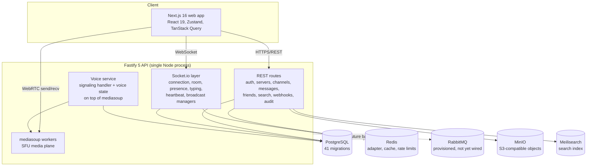

# FreedomTalk

A self-hosted, Discord-style real-time communication platform — Fastify/Socket.io backend, Next.js web client, and a full authentication, permissions, and messaging stack I designed and built end to end as a solo project.

## Overview

FreedomTalk is an open-source communication platform that individuals or communities can run on their own infrastructure. It covers the core Discord feature set: accounts and authentication (including MFA), servers with roles and a hierarchical permission system, channels, direct messages, friends and presence, real-time messaging with reactions, embeds, and file attachments, message/server search, webhooks, audit logs, and experimental WebRTC voice calls backed by a mediasoup SFU.

The problem it solves is ownership: hosted chat platforms control your data, your moderation, and your uptime. FreedomTalk ships everything in a single Docker Compose stack so the operator keeps the data.

I built it alone over roughly eight months (first commit February 2026, most recent October 2026, 183 commits). It is technically interesting because it combines the hard parts of a chat backend in one codebase: a WebSocket layer with connection/room/presence/typing management, a three-state hierarchical permission system shared verbatim between frontend and backend, production-grade authentication flows, and WebRTC media signaling — all with unit and end-to-end test suites. Current status: feature-complete for its core scope, with voice marked experimental and no production deployment yet.

## Why I Built It

I wanted to own a complete real-time product, not an API demo. Chat platforms are one of the few application types that force you to confront almost every backend problem at once — stateful connections, authorization on every event (not just every request), consistency between HTTP and WebSocket paths, background processing, and media transport. Discord's permission model in particular is a genuinely intricate design problem (roles, channel overrides, three-state resolution), and reimplementing it was a deliberate challenge rather than an accident.

There was also a practical motivation: self-hosting. Existing open-source options (Mattermost, Rocket.Chat, Revolt) each trade something away, and I wanted to see whether one person could build a credible alternative core with modern tooling. The original detailed reasoning is not documented beyond what the design docs in `docs/plans/` record.

## Goals

- Implement the core Discord feature set end to end: accounts, servers, channels, roles/permissions, messaging, DMs, friends, search.
- Make authorization correct on both HTTP routes and WebSocket events, with one shared permission definition source.
- Build production-grade account security: email verification, session management, password reset, TOTP MFA.
- Support WebRTC voice without deploying a separate media server, integrated with the permission system.
- Ship with automated tests (unit and end-to-end) rather than manual testing only.
- Make the whole thing self-hostable via Docker Compose.

## My Role

I am the sole author (all 183 commits, February–October 2026). I designed the architecture, the database schema (41 migrations), the API surface, the permission model, the WebSocket layer, the authentication flows, and the Next.js frontend. Some commits carry AI pair-programming co-author trailers; all design decisions, review, and integration were mine.

Third-party infrastructure I used rather than built — this distinction matters:

- **mediasoup** provides the actual WebRTC SFU (media routing, RTP handling, ICE/DTLS). I did not implement WebRTC or an SFU from scratch. What I implemented at the application layer is the signaling flow (transport/producer/consumer orchestration via WebSocket), voice-state persistence, and permission-gated connection logic (~1,350 lines in `services/voice/`).
- **RabbitMQ** is provisioned in Docker Compose and listed in the README for background work, but as far as I can verify there is no AMQP client wired into application code yet. I am flagging this explicitly rather than claiming queue-based processing I did not find in the source. [TODO: confirm intended RabbitMQ consumer/producer work and either wire it up or remove it from the stack description.]
- **Redis** is used for the Socket.io horizontal-scaling adapter, caching, and rate limiting — via the standard clients, not custom infrastructure.
- **MinIO, Meilisearch, PostgreSQL, Sentry, prom-client, speakeasy, nodemailer** are off-the-shelf components I integrated.

## Technology Stack

| Technology | Purpose |
|------------|---------|
| Fastify 5 (Helmet, CORS, rate limiting, Swagger) | HTTP API framework |
| Socket.io 4 + Redis adapter | Real-time WebSocket communication, multi-instance scaling |
| PostgreSQL (via Knex migrations/seeds) | Primary persistence |
| Redis | Socket.io adapter, caching, pub/sub, rate limiting |
| mediasoup | WebRTC SFU for voice (third-party media plane) |
| Next.js 16 (App Router), React 19, Tailwind CSS | Web frontend |
| Zustand + TanStack Query | Client state (ephemeral vs. server state) |
| Zod + shared package | Schema validation, one source of truth for permissions/types |
| MinIO | S3-compatible storage for attachments, avatars, banners |
| Meilisearch | Full-text message and server search |
| speakeasy + qrcode | TOTP MFA with QR enrollment and backup codes |
| nodemailer | Transactional email (verification, password reset) |
| RabbitMQ | Message broker — provisioned, not yet used in application code |
| Vitest + Playwright | Unit, API-integration, and end-to-end tests |
| Docker Compose | Local/self-hosted infrastructure |
| Sentry, prom-client, pino | Error tracking, metrics, logging |

## Architecture

Notable structural choices visible in the code:

- **npm-workspaces monorepo** with `packages/api` (~39k lines of TypeScript), `packages/web` (~28k lines), `packages/shared` (permission flags, Zod schemas, types), and experimental `packages/desktop` (Electron) and `packages/mobile` (React Native) skeletons.
- **The WebSocket layer is decomposed into managers** — `connection.manager`, `room.manager`, `presence.manager`, `typing.manager`, `heartbeat.manager`, `health.monitor`, `message.broadcaster`, `subscription.manager` — with dedicated event handlers for messages, DMs, reactions, and voice, so HTTP and WS paths share the same service layer underneath.
- **mediasoup runs inside the Fastify process** rather than as a separate media server, with configurable worker count and RTC port range; voice state lives in PostgreSQL (`voice_states`), which lets state survive restarts.

### The permission system

The piece I would point a technical reviewer at first. Permissions are 34 BigInt bit flags defined once in `packages/shared`. The model is three-state: a bit can be explicitly allowed, explicitly denied, or neutral (inherited). Resolution walks the hierarchy — channel overrides, then roles, then server defaults — with bitwise operations, so a check is constant time with no database round-trip. The same flag definitions drive backend middleware on REST routes, permission checks inside WebSocket event handlers, and a `useCan` hook on the frontend, so what the UI shows matches what the server enforces.

## Key Technical Decisions

**Decision: integrate mediasoup into the API process instead of a standalone SFU service.**
- **Problem:** voice required an SFU, but deploying and operating a separate media server was out of scope for a self-hosted single-binary goal.
- **Options considered:** a standalone SFU deployment versus embedding mediasoup workers in the Fastify process.
- **Choice:** embed mediasoup in the API process.
- **Reasoning:** simpler self-hosting story (one process, one Compose stack) and direct access to the same database and permission services for connection-time checks.
- **Trade-offs:** media traffic now competes with API traffic for the process; scaling voice independently of HTTP is impossible. Acceptable for the target deployment size; a split would be the first scaling change.

**Decision: a shared package as the single source of truth for permissions and schemas.**
- **Problem:** Discord-style permission logic must behave identically on the server (enforcement) and the client (UI gating), or users see buttons that fail.
- **Choice:** 34 BigInt bit flags plus Zod schemas in `packages/shared`, imported by both API and web.
- **Trade-offs:** couples the frontend release to shared-package changes, but eliminates an entire class of drift bugs.

**Decision: three-state (allow/neutral/deny) permission resolution.**
- **Problem:** roles grant broad rights, but some channels must selectively restrict them.
- **Choice:** explicit deny overrides allow at the same level; unset bits inherit from the parent level, with allow winning when both are set at one level (documented in the source as a safety choice).
- **Trade-offs:** more complex resolution logic than a flat bitmask, but it is what makes per-channel moderation practical.

**Decision: dual access pattern — REST for history/search, WebSocket for immediacy.**
- **Problem:** messages need instant delivery but also paginated history, search, and cacheability.
- **Choice:** Socket.io for live events; REST endpoints (consumed via TanStack Query on the client) for pagination, search, and mutations where idempotency matters.
- **Trade-offs:** two code paths for message creation that must both be permission-checked — which is exactly where I later found and fixed a security hole (below).

**Decision: PostgreSQL for voice state.**
- **Problem:** in-memory voice state dies on restart and diverges from reality.
- **Choice:** persist `voice_states` (with nullable `server_id` so DM calls fit the same table).
- **Trade-offs:** a write per state change; in exchange, restarts recover consistently.

## Most Interesting Technical Problems

**WebSocket auth did not enforce MFA (found via security review).**
- **Problem:** the HTTP middleware enforced MFA and session validity, but the WebSocket handshake had weaker checks — a user who had not completed MFA could still open a socket.
- **Investigation:** compared the HTTP auth middleware path with `services/websocket/auth.middleware.ts` line by line.
- **Solution:** WebSocket auth now requires a valid session with `mfaVerified` state for MFA-enabled users, mirroring the HTTP checks (commit `2b31e85`).
- **Result:** HTTP and WS now have parity on authentication guarantees — which is the actual lesson: in a dual-transport app, every security check must exist on every path.

**Unauthorized DM message injection.**
- **Problem:** message creation did not consistently verify DM participation, so a crafted request could write messages into a DM channel the sender was not part of — over both REST and WebSocket.
- **Investigation:** traced both message-creation paths (HTTP route and WS handler).
- **Solution:** explicit object-level authorization: DM participation checks on both paths, plus channel `SEND_MESSAGES` permission checks in the WS handler (commit `3bef167`).
- **Result:** object-level authorization is now explicit wherever a resource is addressed by ID, rather than relying on route-level checks.

**Password reset stored plain tokens and didn't invalidate sessions.**
- **Problem:** the reset flow wrote plain-text tokens and deleted rows in a table that didn't match the migration schema; completed resets left attacker sessions alive.
- **Solution:** aligned the service with the migration (`password_resets`, hashed `token_hash`, `is_used`/`used_at`/`ip_address` columns) and routed invalidation through the session service so all of a user's sessions are actually revoked (commit `9ffb434`).
- **Result:** the reset flow is now a real security control, not a formality.

**Voice for DMs with one voice-state schema.**
- **Problem:** the `voice_states` table assumed a server channel; DM calls have no server.
- **Solution:** made `server_id` nullable and unified DM and server voice on the same mediasoup infrastructure, with per-context permission checks (membership/participant verification for DMs, `CONNECT`/`SPEAK` for channels).
- **Result:** one voice stack, two contexts, enforced authorization in both.

## What I Learned

- **Every transport is an attack surface.** Adding WebSocket event handlers without re-implementing the REST middleware chain produced real vulnerabilities. My rule now: authorization lives in the shared service layer, never in the transport adapter.
- **Bitwise permission resolution is simple; the state model around it is not.** The three-state hierarchy took several design iterations (there are dedicated design docs and a follow-up migration `add_three_state_permissions`) — the algorithm was never the hard part, deciding what "deny" means across levels was.
- **Testing through the WebSocket layer is structurally harder than through HTTP.** My Vitest unit coverage and Playwright suites lean heavily on the API/REST surface; socket-level integration testing needed its own harness (connection validators, health monitor, heartbeat manager exist partly to make the system observable/testable).
- **Type sharing across a monorepo boundary prevents a category of bug**, but only if you resist redefining "temporary" shapes locally.
- **Integrating mediasoup taught me the WebRTC handshake mechanics** — transport/producer/consumer lifecycles, ICE/DTLS parameter exchange, RTP capabilities — without requiring me to build the media plane itself.

## Challenges and Failures

- A frontend rewrite happened early on (there is a `2026-02-19-frontend-rewrite-design.md` plan two days after the first web design doc) — the first frontend approach did not survive contact with the real-time requirements.
- A user-profile modal redesign was committed and then reverted (`1d13a69`), and re-landed in fixed-up form later — a small example of iterating on UI quality gates.
- The RabbitMQ integration stalled: the broker is provisioned and documented, but the application code was never wired to it. That is an unfinished commitment I should either complete or remove.
- Voice remains marked experimental; I have not validated it under multi-client load.

## Performance / Scale / Results

No formal performance measurements were recorded for this project. The system has not been load-tested and there is no production deployment, so any claims about concurrent users, latency, or throughput would be invented.

Metrics worth adding:

- Concurrent WebSocket connections per process (and message broadcast latency at that load).
- Voice calls: participants per mediasoup worker, CPU per concurrent call.
- Permission-resolution cost (expected constant time — verify it).
- Message send → deliver p50/p95 over the Socket.io path.
- Playwright suite runtime and pass rate as a regression signal.
- [TODO: live deployment URL and measured concurrent-user numbers]

## Security

Actually implemented (verifiable in `services/auth/` and the git history):

- Registration with email verification (nodemailer + a real verification endpoint and flow, fixed in `7f16803`).
- Session management with JWT access/refresh tokens, session invalidation, and revocation on password change/reset.
- Password reset with hashed single-use tokens and IP capture.
- TOTP MFA (speakeasy) with QR enrollment and 10 backup codes, enforced on both HTTP and WebSocket paths.
- GitHub and Google OAuth services.
- Object-level authorization on DM and channel writes (added after the injection fix above).
- Helmet, CORS, rate limiting (with a `SKIP_RATE_LIMIT` toggle for tests), Zod input validation, bcrypt password hashing.
- Audit logs and webhooks as platform features.

I deliberately do not claim the system "is secure" — a third-party security audit has not been performed. The three fixes above came from self-review, which is evidence the review process works, not evidence there are no remaining issues.

## Testing

- **Unit tests (Vitest)** inside the API package, covering routes (auth, channels, servers, users) and services (websocket layer, voice, attachment, search).
- **API integration tests (Playwright, `tests/api`)**: auth, messages, users — run against a real stack (`docker-compose.test.yml`).
- **End-to-end tests (Playwright, Chromium, `tests/e2e`)**: auth, DMs, friends, messaging, servers.
- **Static analysis**: TypeScript strict type-check and ESLint across all packages.

What's missing: socket-level integration coverage is thinner than HTTP coverage, there is no load testing, and no CI pipeline is configured in this repository copy. Highest-value additions: a WebSocket lifecycle test harness (connect, join, send, permission-denied paths) and a multi-client voice signaling test.

## Deployment

The project is designed for self-hosting via Docker Compose (PostgreSQL/TimescaleDB image, Redis 7, RabbitMQ 3, MinIO, Meilisearch), with migrations, seeds, DB backup/restore scripts (`packages/scripts`), and an `.env`-based configuration documented in `docs/setup/`. However, I have not deployed it to a public server: there is no production instance, no monitoring beyond in-process Sentry/metrics endpoints, and no self-hosting deployment guide yet (it is on the roadmap). [TODO: production deployment details, if/when deployed]

## Development History

- **Feb 16, 2026** — first commits: the entire auth and messaging schema (users, sessions, refresh tokens, messages, servers, channels, reactions, DMs) lands in the first two days as 20+ migrations.
- **Feb 17–20, 2026** — roles, member management, invites, permission overwrites, voice states, discovery, webhooks, audit logs; dedicated design docs for the frontend, voice/video, and the hierarchical permission system; the frontend rewrite.
- **Mar 2026** — the security hardening pass: MFA/session enforcement in WebSocket auth, DM injection fix, password-reset overhaul, real email verification.
- **Later 2026** — DM voice/video calling, vanity URLs, server icon/banner uploads, search and discovery polish, landing page redesign, beads-based issue tracking.
- **Oct 7, 2026** — latest commit: a security dependency upgrade (Next 16.4.0) and the comprehensive README.

The arc is: schema-first foundation, feature build-out, then a sustained correctness/security phase — roughly 183 commits, all authored by me.

## What I Would Do Differently

- **Wire RabbitMQ or cut it.** Provisioning infrastructure that no code uses is worse than not having it — it misleads readers of the stack list (including me, later).
- **Design the HTTP/WS authorization parity check from day one**, e.g. a shared test matrix that runs every authorization rule against both transports. The MFA and DM bugs would have been caught by that, not by review.
- **Measure early.** I built a health monitor and Prometheus-style metrics endpoints but never captured a single load-test number. A one-evening k6 run at each milestone would have cost little.
- **Decompose the API process earlier.** Embedding mediasoup in the API process was right for shipping, but I would now design the interface boundaries (voice control plane vs. media plane) so splitting later is mechanical.
- **Set up CI before the test suites grew.** Vitest + Playwright only protect the code if something runs them on every push.

## Current Status

🟡 Experimental / actively developed. Core features are implemented end to end with test coverage; voice is experimental; desktop and mobile packages are skeletons; there is no production deployment. Development is ongoing (commits within the current month).

## Skills Demonstrated

- **Backend:** Fastify 5 API design, REST + WebSocket dual-transport architecture, Socket.io room/presence/typing management, Redis adapter scaling pattern.
- **Architecture:** npm-workspaces monorepo, shared schema/type boundary, service-layer decomposition (~40 services), multi-service Docker Compose topology.
- **Database:** 41-migration Knex schema covering auth, messaging, communities, voice, search analytics; indexing migrations.
- **Security:** session/JWT/refresh design, TOTP MFA, OAuth integration, object-level authorization, hashed reset tokens, audit logging.
- **Real-time/media:** WebRTC signaling orchestration over mediasoup, voice-state persistence, permission-gated media connections.
- **Frontend:** Next.js 16 App Router, React 19, Zustand/TanStack Query state split, Tailwind design system.
- **Testing:** Vitest unit suites, Playwright API-integration and E2E suites, test-dedicated Compose stack.

## Portfolio Relevance

- **What this project demonstrates:** the ability to carry a large, stateful, multi-transport backend from schema design through security hardening to tested feature completeness — solo, over eight months, with the discipline to write design docs and then fix my own security bugs in a dedicated pass.
- **Why it is interesting:** unlike a tutorial chat app, it has the unglamorous parts done: three-state hierarchical permissions shared across the stack, session revocation that actually works, E2E tests, audit logs, and migrations that tell a coherent story. The permission system alone is a discussable design artifact.
- **Limitations:** no production deployment, no measured scale, voice unvalidated under load, RabbitMQ provisioned but unused, no CI in this copy. Using mediasoup means this is not evidence of WebRTC/SFU internals expertise — the demonstrated skill is integrating and orchestrating it correctly.
- **Best thing to show a recruiter:** the permission-system design plus the security-fix commit trail (`2b31e85`, `3bef167`, `9ffb434`) — concrete proof of both systems design and the follow-through to find and fix authorization bugs. A live demo with measured concurrent-connection numbers would be the strongest possible addition.

## Interview Discussion

1. Walk me through resolving a permission check where a channel denies `SEND_MESSAGES` for a role that the server allows. How do your three states interact across hierarchy levels?
2. You enforce MFA on HTTP and WebSocket. How do you ensure no future transport or endpoint misses the check — what would you restructure?
3. Why run mediasoup inside the API process, and at what point would you split it out? What breaks first?
4. How does the Socket.io Redis adapter work, and what consistency problems can appear when broadcasting across instances?
5. Describe the password-reset flow end to end. Why hash the reset token, and what does session revocation need to cover?
6. What does "object-level authorization" mean for a message-create handler, and where exactly did the DM injection bug live?
7. If 5,000 users connect concurrently to one process, what do you expect to fail first, and what would you measure to confirm it?

## Honest Assessment

Internal portfolio-evaluation ratings (1–10, subjective):

| Dimension | Rating | Rationale |
|-----------|--------|-----------|
| Technical Depth | 8 | Real stateful-systems problems solved (dual-transport auth, three-state permissions, signaling, voice state) with evidence in the commit trail. |
| Engineering Quality | 7 | Layered services, shared schemas, 41 clean migrations, unit + E2E tests; held back by no CI, unused RabbitMQ, and thin socket-level test coverage. |
| Uniqueness | 6.5 | "Another Discord clone" is a crowded category; the completeness, permission model, and security history differentiate it. |
| Real-World Value | 7 | Genuine self-hosted value proposition, but unproven without a deployment and users. |
| Portfolio Value | 7 | Strong as a codebase to read; would be a 9 with a live demo and measured concurrent-user metrics, which are currently the missing artifacts. |

## Recruiter Summary

- **In one sentence:** I solo-designed and built a self-hosted Discord-style chat platform — Fastify/Socket.io backend, Next.js frontend, PostgreSQL/Redis persistence, MFA-secured accounts, and permission-gated WebRTC voice over mediasoup — with unit and end-to-end test suites.
- **The strongest signal this project sends:** I can own a large real-time system end to end, including the security-correctness pass most hobby projects skip (documented in the git history itself).
- **The biggest weakness:** nothing has been measured or deployed — no live instance, no load numbers, no users.
- **What I would improve before showcasing it:** deploy a public demo, wire up or remove RabbitMQ, add CI, and run a load test so the concurrent-connection claims are numbers instead of adjectives.

## Evidence & Missing Information

**Evidence inspected for this case study:** repository root and `packages/` layout; `README.md`; `package.json` manifests (root, api, shared); `docker-compose.yml`; `packages/api/src/` service and route structure; `packages/shared/src/permissions.ts` (34-flag three-state model); `packages/api/src/services/voice/` (mediasoup integration, ~1,350 lines); `packages/api/migrations/` (41 migrations); `tests/api` and `tests/e2e` Playwright suites; `docs/plans/` and `docs/product/` design documents; git history (183 commits, single author, 2026-02-16 → 2026-10-07, including security-fix commits `2b31e85`, `3bef167`, `9ffb434`); and the project dossier.

**Missing information:**

- [TODO: live demo URL and measured concurrent-user/connection numbers]
- [TODO: load-test or latency measurements (none exist)]
- [TODO: RabbitMQ producer/consumer code — provisioned in Compose but not found wired into application source]
- [TODO: CI configuration (none present in this repository copy)]
- [TODO: production deployment details (not yet deployed)]
- [TODO: original motivation details beyond the design docs and README]
