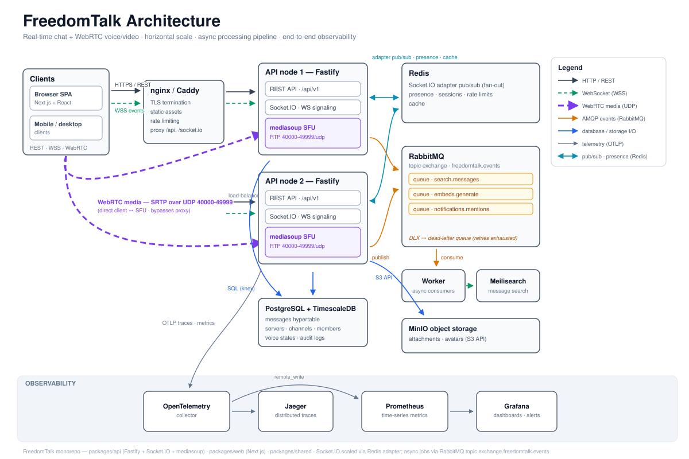

<p align="center">
  <h1 align="center">FreedomTalk</h1>
  <p align="center"><strong>Own Your Conversations.</strong></p>
  <p align="center">An open-source, self-hosted real-time communication platform.</p>
<p align="center">
  <a href="https://github.com/notdezzi/freedomtalk/actions/workflows/e2e.yml"></a>
</p>

---

FreedomTalk is a Discord-style communication platform you can run on your own infrastructure.
It ships a Fastify + Socket.io backend and a Next.js web app organized as an npm-workspaces
monorepo, backed by PostgreSQL, Redis, and RabbitMQ. Core community features are implemented
end to end — accounts and authentication, servers with roles and permissions, channels,
direct messages, friends, real-time messaging with reactions and attachments, search, and
WebRTC-based voice — with automated test coverage at both the API and end-to-end levels
(500+ Vitest unit/integration tests on real Postgres/Redis/RabbitMQ via Testcontainers,
Playwright suites, and a k6 load suite with published results).

## Features

- **Accounts & Authentication** — registration with email verification, login with sessions,
  JWT access/refresh tokens, password reset, multi-factor authentication (TOTP), and session
  invalidation.
- **Servers (Communities)** — create and manage servers with channels, roles, and a
  permission system; server discovery and invite links.
- **Real-Time Messaging** — instant chat over Socket.io with Markdown formatting, emoji
  reactions, embeds, and file attachments.
- **Direct Messages & Friends** — one-on-one DMs, friend requests, and presence.
- **Search** — message and server search.
- **Voice** — WebRTC voice backed by a mediasoup SFU (experimental).
- **Worker Pipeline** — message events flow through RabbitMQ (topic exchange, per-queue
  consumers with retry + dead-letter semantics) to background workers for Meilisearch
  indexing, link-embed generation, and mention notifications — off the request path.
- **Observability** — readiness endpoint probing every dependency (`/ready`), OpenTelemetry
  traces propagated across the API → RabbitMQ → worker boundary, structured pino logging,
  and Prometheus metrics with a shipped Grafana dashboard (`deploy/`).
- **Platform Plumbing** — webhooks, audit logs, and Prometheus-style metrics endpoints.
- **Self-Hosted** — everything runs in Docker Compose on your hardware. Your data, your rules.

## Architecture



Messages traverse the API once and fan out through RabbitMQ to the search, embed, and
mention workers; Socket.io state (presence, typing) propagates across API nodes over a
Redis pub/sub bus, so the gateway scales horizontally. See [`docs/scaling.md`](./docs/scaling.md)
for the multi-node topology and the mediasoup SFU scaling path.

## Tech Stack

### Backend (`packages/api`)

| Technology | Purpose |
|------------|---------|
| [Fastify 5.x](https://fastify.dev/) | High-performance HTTP framework (Helmet, CORS, rate limiting, Swagger) |
| [Socket.io 4.x](https://socket.io/) | Real-time WebSocket communication (Redis adapter for scaling) |
| [PostgreSQL](https://www.postgresql.org/) + [Knex](https://knexjs.org/) | Persistence with migrations and seeds |
| [Redis](https://redis.io/) | Caching, pub/sub, rate limiting |
| [RabbitMQ](https://rabbitmq.com/) | Message queue for background work |
| [mediasoup](https://mediasoup.org/) | WebRTC SFU for voice |
| TypeScript + Zod | Type-safe development and schema validation |

### Frontend (`packages/web`)

| Technology | Purpose |
|------------|---------|
| [Next.js 16](https://nextjs.org/) (App Router) | React framework |
| [React 19](https://react.dev/) | UI |
| [Tailwind CSS](https://tailwindcss.com/) | Styling |
| Socket.io Client | Real-time updates |

### Infrastructure

- **Docker / Docker Compose** — containerized development environment
- **npm Workspaces** — monorepo management

## Quick Start

### Prerequisites

- **Node.js** 20+
- **npm** 10+
- **Docker** & **Docker Compose**

### Installation

1. **Clone the repository**
   ```bash
   git clone https://github.com/notdezzi/freedomtalk.git
   cd freedomtalk
   ```

2. **Install dependencies**
   ```bash
   npm install
   ```

3. **Start infrastructure services**
   ```bash
   npm run docker:up
   ```

4. **Configure environment variables**
   ```bash
   cp packages/api/.env.example packages/api/.env
   cp packages/web/.env.example packages/web/.env.local
   ```

   > Update the `.env` files with your specific configuration before proceeding.

5. **Run database migrations**
   ```bash
   npm run migrate:latest --workspace=@freedomtalk/api
   ```

6. **Launch development servers**
   ```bash
   npm run dev
   ```

Your FreedomTalk instance is now running.

## Available Commands

### Root Level

```bash
npm run dev              # Start all packages in development mode
npm run build            # Build all packages for production
npm run start            # Start production servers
npm run format           # Format code with Prettier
npm run type-check       # TypeScript type checking
npm run test:unit        # Vitest unit + integration tests (Testcontainers)
npm run clean            # Remove build artifacts
```

### Docker Infrastructure

```bash
npm run docker:up        # Start PostgreSQL, Redis, RabbitMQ
npm run docker:down      # Stop all services
npm run docker:logs      # View service logs
```

### API Package

```bash
npm run dev --workspace=@freedomtalk/api              # Development server
npm run migrate:latest --workspace=@freedomtalk/api   # Run migrations
npm run migrate:make --workspace=@freedomtalk/api     # Create a migration
npm run test --workspace=@freedomtalk/api             # Run Vitest unit tests
```

### Web Package

```bash
npm run dev --workspace=@freedomtalk/web    # Development with Turbopack
npm run build --workspace=@freedomtalk/web  # Production build
npm run start --workspace=@freedomtalk/web  # Production server
```

### Testing

Unit and integration tests run on [Vitest](https://vitest.dev) against **real dependencies**
spun up with [Testcontainers](https://testcontainers.com) (Postgres, Redis, RabbitMQ) — no
mocked repositories. End-to-end and API-level flows use [Playwright](https://playwright.dev).
All of it runs in CI on every push.

```bash
npm run test:unit        # Vitest unit + integration tests (Testcontainers)
npm test                 # Full Playwright suite (API + e2e)
npm run test:api         # API integration tests only
npm run test:e2e         # End-to-end tests (Chromium)
npm run test:ui          # Interactive Playwright UI mode
```

The Socket.IO gateway, message pipeline, voice signaling plane, and connection churn are
additionally covered by a [k6 load suite](./load) with published results — message ack
p95 of 13 ms at 20 VUs and 10,400 churn cycles/min with zero failures on a 20-core dev box.

## Project Structure

```
freedomtalk/
├── packages/
│   ├── api/          # Backend API server (Fastify + Socket.io + mediasoup)
│   ├── web/          # Web application (Next.js)
│   ├── shared/       # Shared types, permissions, and utilities
│   ├── desktop/      # Desktop app (Electron) — experimental
│   ├── mobile/       # Mobile app (React Native) — experimental
│   └── scripts/      # DB backup/restore and maintenance scripts
├── tests/            # Playwright e2e tests
├── load/             # k6 load tests + published results (load/README.md)
├── docs/             # Setup, architecture, scaling, and roadmap docs
├── deploy/           # Prometheus, Grafana dashboard, OTel collector, nginx configs
├── docker-compose.yml          # Local infra + observability stack
├── docker-compose.scale.yml    # Multi-node topology (2 API nodes + worker behind nginx)
├── docker-compose.prod.yml     # Production deployment (Caddy TLS, WebRTC port range)
├── Dockerfile.api     # API + worker image (multi-stage, npm workspaces)
├── playwright.config.ts
└── package.json
```

## Infrastructure Services

| Service | Port | Purpose |
|---------|------|---------|
| PostgreSQL | 5432 | Primary database |
| Redis | 6379 | Caching, pub/sub, rate limiting, multi-node WS bus |
| RabbitMQ | 5672 | Domain-event pipeline (search/embeds/mentions workers) |
| RabbitMQ Management | 15672 | Admin UI at `http://localhost:15672` |
| Meilisearch | 7700 | Message/server search index |
| OTel Collector | 4318 | OpenTelemetry trace ingestion (→ Jaeger at `http://localhost:16686`) |
| Prometheus | 9090 | Metrics scraping |
| Grafana | 3001 | Dashboards at `http://localhost:3001` (provisioned from `deploy/`) |

## Roadmap

### Shipped

- [x] Monorepo architecture with npm workspaces
- [x] Backend API with Fastify + Socket.io
- [x] Frontend application with Next.js
- [x] Authentication: sessions, JWT refresh, email verification, password reset, MFA
- [x] Servers, channels, roles, and permissions
- [x] Real-time messaging with reactions, embeds, and attachments
- [x] Direct messages and friends
- [x] Search
- [x] Webhooks, audit logs, and metrics
- [x] RabbitMQ worker pipeline (search indexing, link embeds, mention notifications)
- [x] OpenTelemetry tracing across the API → queue → worker boundary
- [x] Multi-node WebSocket: Redis-backed presence/typing, `docker-compose.scale.yml`
- [x] API (Vitest) and end-to-end (Playwright) test suites, k6 load suite

### In Progress

- [x] Voice calling (mediasoup SFU) — experimental
- [ ] Desktop application (Electron)
- [ ] Mobile application (React Native)

### Planned

- [ ] Plugin/extension system
- [ ] Self-hosting deployment guides

## Documentation

Documentation is organized under [`docs/`](./docs):

- Quickstart: [`docs/QUICKSTART.md`](./docs/QUICKSTART.md)
- Setup and environment guides: [`docs/setup`](./docs/setup)
- Architecture and tech stack: [`docs/architecture`](./docs/architecture)
  ([architecture diagram](./docs/architecture/architecture.svg))
- Scaling to multiple nodes: [`docs/scaling.md`](./docs/scaling.md)
- Production deployment: [`docs/deploy.md`](./docs/deploy.md)
- Load testing: [`load/README.md`](./load/README.md)
- Product features and roadmap: [`docs/product`](./docs/product) and [`docs/roadmap`](./docs/roadmap)

## Development Workflow

1. Create a feature branch from `main`
2. Implement your changes
3. Run quality checks:
   ```bash
   npm run type-check
   ```
4. Build all packages:
   ```bash
   npm run build
   ```
5. Test your changes:
   ```bash
   npm test
   ```
6. Commit, push, and open a pull request

---

<p align="center"><strong>FreedomTalk</strong> — Because your conversations deserve freedom.</p>
